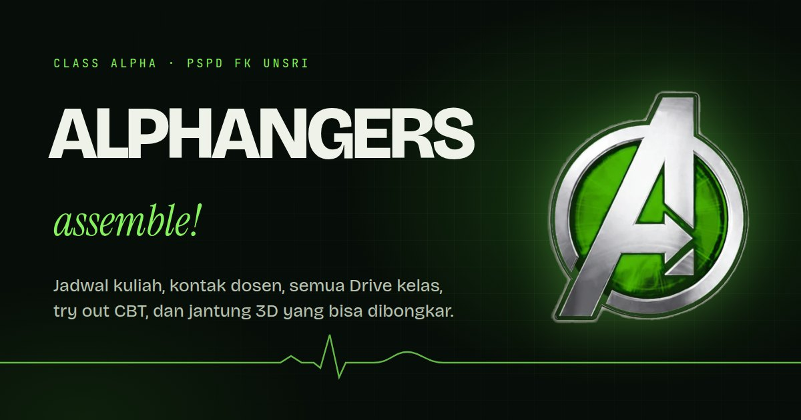

# Alphangers

Class portal for **Class Alpha**, Program Studi Pendidikan Dokter, Fakultas Kedokteran Universitas Sriwijaya (angkatan 2026).

> Portal kelas Alpha: jadwal kuliah hari ini, kontak dosen, semua Drive kelas, try out CBT dan OSPE, model jantung 3D yang bisa dibongkar, divisi kelas, dan foto angkatan. Admin bisa mengubah isi halaman langsung dari halamannya. Panduan admin dan setup Firebase ada di [`docs/`](docs/) dalam Bahasa Indonesia.



## What it does

| Section | What a student gets |
| --- | --- |
| **Jadwal** | Today's sessions with time, room, lecturer and phone, a week strip and month calendar for any past or future date, what is on now and next, a countdown to the next exam, search across every session, and export to Google Calendar or `.ics`. A cancelled session keeps its place with a red tape across it and the reason, and drops out of "now and next" and the exam countdown. A session whose hour is not out yet (the Blok 4 CBT, for now) says "Jam menyusul" instead of a made-up time and goes into calendars as an all-day event. Blok 1 to Blok 4 are in. All times are Palembang time (WIB) whatever the device clock says. |
| **Drive** | The class channels from v3 (Drive folders and the CBT try out), unchanged in behaviour, plus the OSPE try out: eleven in all. Each channel's page can carry a note from the admin. |
| **Dosen** | 477 lecturers with specialty, block codes, call, WhatsApp and copy buttons, an A to Z index, and each lecturer's sessions in this class. Filters narrow: Blok 1 plus Spesialis non-dokter shows only the people who are both. The list opens to everyone and folds back to the short version. |
| **Siklus jantung** | The scroll-driven heartbeat and ECG walkthrough from v3. |
| **Jantung 3D** | An original 3D heart with 55 clickable parts (chambers, great vessels, coronary arteries and cardiac veins, valves, chordae and papillary muscles, the conduction system). Each part has anatomy, function, key numbers, blood supply, clinical notes and its ECG link. Four views: whole, cut (frontal, four chamber, valve plane), electrical (a depolarisation wave synced to a live ECG trace) and blood flow (particles along the real routes, faster in systole). |
| **Divisi** | The eight class divisions (BPH, Batu, Didis, Jarkom, Medinfo, Pleno, Praktikum, Solid), each with a description and up to three main photos on a small stack you flip through, plus more photos in the full view. Photos open in a viewer with pinch, double tap and wheel zoom. |
| **Foto kelas** | The whole class in one photo, the last thing before the footer. |
| **Search** | `Ctrl K` / `⌘ K` / `/` searches sessions, lecturers, channels and heart parts at once, and accepts Indonesian or English spelling (`genetik` finds "Genetic"). |
| **Pengumuman** | Announcements posted from the admin editor, with deadlines and countdowns. Hidden when there is nothing current. |
| **Try out CBT** | The class's own question banks, Blok 2 (279 questions) and Blok 3 (270, written by the Batu division), with cards for Blok 1 and Blok 4 waiting for theirs, in Latihan with the answer and explanation right away or Simulasi CBT with a timer and answers at the end, plus pictures, flags, filters by topic and a review of every attempt. The 84 Blok 3 questions that came out in Her Dini carry a Soal Herdini tag, and Blok 3 has a third mode, Her Dini, to practise just those. Only Kelas Alpha can open them: a classmate signs in with Google and matches their NIM once, and admins can close the try out for any person or account. Works offline after the first open. Every text on it (card titles, "Disusun ..." credit lines, the sign-in screens) and a note per page can be changed from the editor. |
| **Try out OSPE** | Its own channel next to the CBT one, with its own cards for Blok 1 to Blok 4. Blok 3 is the Praktikum division's bank: their practicum quiz and their OSPE try out merged into 131 questions (duplicates kept once), with the preparation photos, embryo photos and labelled diagrams from the quiz. The same Latihan and Simulasi OSPE modes, filters, flags, review, sign-in, NIM check, blocked list and offline use as the CBT try out; questions that came with the key only show the answer without an explanation. |
| **Offline** | Installable as an app. After one visit the schedule, lecturer list and heart still open without signal. |

Everything is editable without touching code. An admin signs in with Google on the portal itself (the Admin button in the footer, `/?admin`, or `Ctrl Shift E`) and switches between **Lihat**, **Edit** and **Panel**: in edit mode every heading and paragraph can be typed over, on the channel pages and the try out too, and every session, lecturer, channel, announcement, division and photo can be added, changed or removed. Changes stay a draft, with undo and redo, until **Terbitkan** saves them to Firestore. **Panel** opens the full form editor (forms per block and lecturer, JSON, version history) over the page with the same drafts; it also still works on its own at `/admin/`. See [docs/ADMIN.md](docs/ADMIN.md). Until Firebase is configured, the site runs entirely from the JSON in this repository and makes no third-party requests.

## Stack

- **Vite 8**, vanilla ES modules, no framework. Each section is its own lazily loaded module.
- **three.js** for the heart explorer, with its own shaders for per-part colour, highlighting, x-ray, the depolarisation wave and cut faces, lit by studio lighting baked once at load from the physical material. Picking renders part ids into an 11×11 target around the pointer and takes the nearest hit, so thin structures such as the conduction fibres and chordae are easy to tap.
- **Python** (NumPy, SciPy, scikit-image, trimesh, fast-simplification) to sculpt the heart as signed distance fields, mesh it, label every vertex with its part, bake ambient occlusion and activation times, then **glTF Transform + meshoptimizer** to pack and simplify it (466 KB).
- **Firebase** Auth + Firestore for the admin, read by the portal over plain REST. Visitors never load the Firebase SDK; it is fetched only when someone opens the editor.
- **Netlify Functions + Netlify Blobs** for photo uploads (the browser strips metadata and makes the smaller copies, a function checks the admin's Firebase token and the file's real type, rate limits, and stores it under a content hash) and for try out access (who may open the sealed banks, the blocked list, the log).
- **WebCrypto** (AES-256-GCM, HKDF) to seal the try out banks and the class list at build time and open them in the browser.
- **sharp** at build time for the bundled photos (AVIF and WebP sizes, the original kept for zoom).
- **Playwright** and `node:test` for tests; **Netlify** for hosting, with a strict Content Security Policy.

## Getting started

```bash
npm install
npm run dev          # http://127.0.0.1:5173
npm run build        # production build in dist/
npm run preview      # serve dist/
```

Node 20 or newer. Python 3.11+ is only needed to rebuild data or the heart model.

## Scripts

| Command | Does |
| --- | --- |
| `npm test` | Unit tests: schedule model, validator, content layer, photo metadata stripping, upload token checks, try out sealing, function and access state |
| `npm run test:e2e` | Builds (plus a mock-backend build in `dist-mock/`), then runs the browser suites: portal (6 viewports, reduced motion, storage blocked, no WebGL, axe), schedule and lecturers, admin, the live editor, the try out and the Peserta try out tab |
| `npm run test:rules` | Firestore security rules against the emulator (needs Java 21) |
| `npm run data` | Rebuilds `src/data/schedule.json` from the checked transcripts in `content/jadwal/`, and `dosen.json` when given the lecturer sheet (`npm run data -- path/to/kontak-dosen.xlsx`; the sheet itself is not in the repo) |
| `npm run heart` | Rebuilds the heart model from `scripts/heart/` into `public/models/` |
| `npm run cbt:seal` | Seals the try out from a private folder kept outside the repo: `npm run cbt:seal -- --private ../cbt-private` writes `public/cbt/`, `src/data/cbt.json` and `netlify/data/cbt.mjs` (see [docs/ARCHITECTURE.md](docs/ARCHITECTURE.md#try-out-access)) |
| `npm run cbt:fixtures` | Rebuilds the made-up try out banks in `tests/fixtures/cbt/` that mock builds and tests use |
| `npm run media` | Prepares a bundled photo: `npm run media -- photo.jpg public/img/divisi/name "alt text"` writes the sizes and prints the record to paste into a content file |

## Repository map

```
index.html              portal page
admin/                  admin editor page
src/main.js             portal entry: mounts sections as they come near
src/legacy/             the v3 shell (hero, loader, channels, try out, heartbeat section)
src/features/           jadwal, dosen, anatomi (3D heart), info (announcements), find (search),
                        divisi, kelas (class photo), viewer (photo zoom)
src/lib/                content layer, validator, schedule model, calendar export, page texts, photos
src/edit/               the editor that runs on the portal (loaded only for admins)
src/admin/              the /admin/ form editor and the Firebase backend both editors use
netlify/                upload, photo-serving and try out access functions
src/data/               bundled content (the fallback for everything)
content/                cleaned schedule text
scripts/heart/          the heart model pipeline
scripts/media.mjs       photo sizes for bundled images
public/                 static files: model, photos, icons, sealed try out files, service worker, manifest
tests/                  unit, browser and rules tests
docs/                   architecture, security, admin and Firebase guides
```

## Documentation

- [docs/ARCHITECTURE.md](docs/ARCHITECTURE.md): how the page is put together, the content layer, the heart pipeline and renderer.
- [docs/SECURITY.md](docs/SECURITY.md): threat model, headers, Firestore rules, the live editor, photo uploads, try out access, privacy.
- [docs/ADMIN.md](docs/ADMIN.md): editing on the page and in `/admin/` (Bahasa Indonesia).
- [docs/FIREBASE_SETUP.md](docs/FIREBASE_SETUP.md): connecting Firebase, step by step (Bahasa Indonesia).

## Medical content

The heart notes are a study summary written for first-year medical students and checked against standard anatomy and physiology texts and open clinical references. They are not a substitute for the block's lecture slides and textbooks, and the site says so under every part.

## License

Copyright © 2026 Raffa Gamadan Rifandi (ResVet). All rights reserved. See [LICENSE](LICENSE). Third-party software keeps its own license; see [NOTICE](NOTICE).
